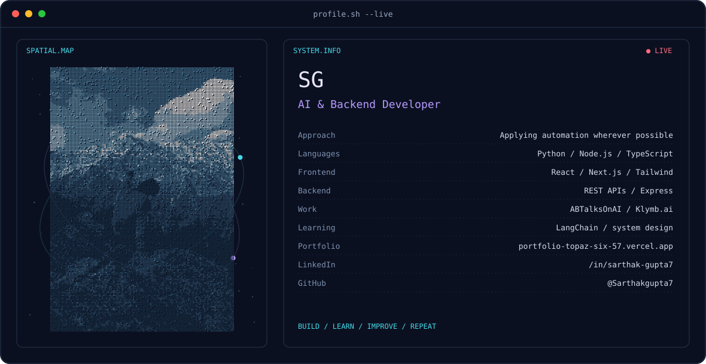
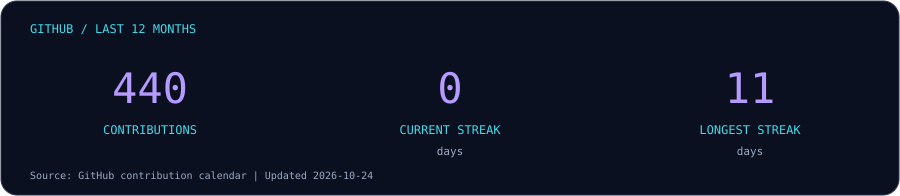
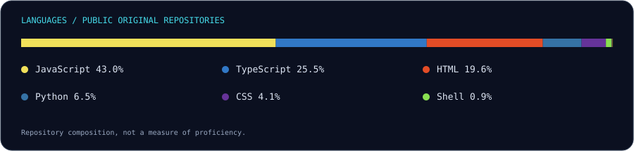

  

  
  

## 👋 About me

I'm **Sarthak Gupta**. I build AI-powered applications and backend systems with Python and Node.js, connecting LLMs, APIs, and automation to practical product workflows.

My work spans developer tools, learning platforms, and community products. I also work across **ABTalksOnAI** and **Klymb.ai**, bringing engineering together with product, growth, and operations.

- **Building:** AI-integrated applications, backend services, and web products.
- **Exploring:** agentic workflows, LangChain, and reliable LLM integration.
- **Practicing:** data structures, algorithms, and problem solving.
- **Interested in:** AI, backend engineering, and tools that make complex work easier.

## 🚀 Selected projects

| Project | What it does | Focus |
| :--- | :--- | :--- |
| [GitHub Repo Roaster](https://github.com/Sarthakgupta7/github-roaster) | AI-powered repository feedback, code-quality analysis, and developer tools. | React · Node.js · Groq |
| [Klymb.ai](https://github.com/Sarthakgupta7/klymb-ai) | A learning platform frontend for structured job-readiness tracks. | TypeScript · learning experiences |
| [Repo Radar](https://github.com/Sarthakgupta7/repo-radar) | Tracks trending and newly created GitHub repositories, ranked by stars and forks. | TypeScript · GitHub discovery |
| [AI Code Reviewer](https://github.com/Sarthakgupta7/code-reviewer) | An AI-powered tool for source-code feedback, explanations, and improvement suggestions. | React · Node.js · Gemini |
| [Netflix EDA](https://github.com/Sarthakgupta7/EDA-Netflix) | Exploratory data analysis of Netflix content. | Python · data analysis |

## 🛠️ Tech stack

**Languages**

**Web &amp; backend**

**Tools &amp; data**

**AI interests:** LLM integration · LangChain · prompt engineering · agentic systems

## 📊 GitHub activity

Cards refresh daily. Contribution counts follow GitHub's visibility settings; language shares reflect code bytes in public repositories.

## 🐍 Contribution snake

<picture>
  <source media="(prefers-color-scheme: dark)" srcset="https://raw.githubusercontent.com/Sarthakgupta7/Sarthakgupta7/main/assets/snake-dark.svg" />
  <source media="(prefers-color-scheme: light)" srcset="https://raw.githubusercontent.com/Sarthakgupta7/Sarthakgupta7/main/assets/snake-light.svg" />
  
</picture>

## 🌱 What I'm learning

| Area | Topics |
| :--- | :--- |
| Agentic AI | Tool use, structured workflows, and LLM orchestration |
| Backend engineering | API design, reliability, and automation |
| Computer science | DSA, OOP, databases, and system design |
| Product development | Connecting useful features with clear user experiences |

## 🤝 Let's build something useful

I'm interested in conversations around AI applications, backend systems, developer tools, and learning products.

**[Visit my portfolio](https://portfolio-topaz-six-57.vercel.app/) · [Explore my repositories](https://github.com/Sarthakgupta7?tab=repositories)**

Build. Learn. Improve. Repeat.

